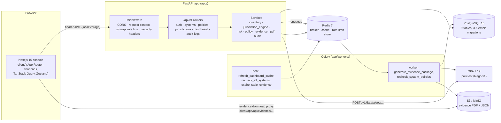

# State of the Project

_Assessed 2026-11-18 on `production` @ `4acb5f8`. Everything below was observed by reading
the code or running it; nothing is inferred from the README alone._

## TL;DR

The backend is in better shape than most v0.1 projects: 259 passing tests, 86 % line
coverage, ruff clean, a coherent API with an audit trail, and a real end-to-end flow
(register → detect jurisdictions → classify risk → OPA policy check → PDF/JSON evidence)
that **works once the stack boots**. The frontend builds, type-checks and lints clean and
covers every backend feature except policy authoring.

Three things stand between this and a public launch:

1. **`docker compose up` fails for every new contributor today.** The pinned MinIO image
   (`docker-compose.yml:95`) can no longer be pulled from any registry.
2. **Only the EU AI Act is enforced as policy-as-code.** California, China and India are
   detected and risk-classified, but there is no Rego for them, so a China-only GenAI
   system is checked against EU and global rules only. The marketing claim
   ("models four regimes") must match this or the gap must close.
3. **No CI at all.** `.github/` contains issue templates but no `workflows/`.

## 1. Architecture

Monorepo layout: Python backend at the repo root (`app/`, `alembic/`, `policies/`,
`tests/`, `scripts/`, `docker/`), Next.js console in `client/`. One `docker-compose.yml`
runs 8 services: postgres, redis, opa, minio, api, worker, beat, client.

## 2. Backend inventory

### API endpoints (41 routes)

| Router | File | Endpoints |
|---|---|---|
| health (unwrapped) | `app/api/v1/routers/health.py` | `GET /health`, `/health/live`, `/ready`, `/health/ready`, `/metrics` (Prometheus, hidden from schema) |
| auth | `app/api/v1/routers/auth.py` | `POST /auth/login`, `POST /auth/refresh`, `GET /auth/me`, `GET /auth/mode`, `GET/POST /auth/users`, `PATCH /auth/users/{id}` — **no self-registration**; admins create users |
| systems | `app/api/v1/routers/systems.py` | CRUD + `restore`, `versions`, `classify`, `classifications`, `check-policies`, `policy-checks`, `evidence` (create/list/get/retry) — 15 routes |
| policies | `app/api/v1/routers/policies.py` | CRUD, `POST /sync-opa`, `POST /batch-check` |
| jurisdictions | `app/api/v1/routers/jurisdictions.py` | list, create, get, patch, `GET /detect/{system_id}` (dry run) |
| dashboard | `app/api/v1/routers/dashboard.py` | `summary`, `by-jurisdiction`, `recent-failures`, `pending-reviews` |
| audit-logs | `app/api/v1/routers/audit.py` | list (filterable), get one |

Every `/api/v1` response uses a `{success, data}` / `{success, error}` envelope
(`app/api/envelope.py`), reflected into OpenAPI by `envelope_openapi()`.

### Data model (`app/models/`)

`users`, `ai_systems` (soft-delete), `system_metadata`, `system_metadata_versions`
(immutable history), `jurisdictions` (overlay config + risk taxonomy as JSONB),
`risk_classifications` (immutable rows), `policies` (versioned, soft-delete),
`policy_checks`, `evidence_packages`, `audit_logs`.

Migrations: `alembic/versions/0001_initial_schema.py`, `0002_system_reach_regions.py`,
`0003_optional_auth_audit.py`. All three applied cleanly against Postgres 16 in the test run.

### Celery (`app/workers/tasks.py`)

`generate_evidence_package` (L39), `recheck_system_policies` (L67), `recheck_all_systems`
(L80), `refresh_dashboard_cache` (L95), `expire_stale_evidence_packages` (L104). Beat
schedule in `app/workers/celery_app.py:38`.

### Regulation coverage — the important table

| Jurisdiction | Detection (`jurisdiction_engine.py`) | Risk taxonomy (`app/db/seed.py`) | Rego policies (`policies/`) | Rego tests |
|---|---|---|---|---|
| **EU AI Act** | ✅ 6 triggers | ✅ L102–138: prohibited/high/limited, 5 prohibited + 9 high-risk use cases | ✅ `eu_prohibited.rego` (9 rules), `eu_high_risk.rego` (17 rules, Art. 9–15/43/49/72/73), `eu_transparency.rego` (7 rules, Art. 50), shared `eu_ai_act_base.rego` | ✅ 3 files, ~35 tests |
| **California ADMT** | ✅ L141–186 | ✅ high/limited, 4 consequential use cases | ❌ **none** | ❌ |
| **China GenAI / PIPL** | ✅ L188–233, incl. service/content accessibility | ✅ prohibited/high/limited, min tier `limited` | ❌ **none** | ❌ |
| **India DPDP** | ✅ L235–270 | ✅ high/limited | ❌ **none** | ❌ |
| Global baseline | ✅ always | — | ⚠️ `global/global_transparency.rego` — 3 rules, **pre-contract**: emits `rule` not `rule_id`, no `article`/`severity`/`in_scope`/`decision` | ❌ |
| Shared lib | — | — | ✅ `common/aigov_common.rego` incl. `obligation()` / `readiness_violation()` for laws not yet in force | ✅ |

Observed in the live run: "Storefront Face Analytics" (deployed in CN, biometric) is
correctly detected as CN-applicable, but its policy check runs only the 3 EU packages + the
global baseline. CN, CA and IN obligations exist only as text lists in the risk taxonomy,
not as evaluable rules.

### Storage (`app/services/storage.py`)

boto3 against any S3 endpoint; bucket auto-created (`ensure_bucket`, L31). Presigned URLs are
signed against the internal host (`http://minio:9000`), so the Next.js route
`client/app/api/evidence/[systemId]/[packageId]/route.ts` proxies downloads. Works with
SeaweedFS as a drop-in (verified).

### Auth (`app/core/security.py`, `app/api/deps.py`)

JWT (HS256 via `python-jose`) access + refresh, bcrypt via `passlib`, 3 roles
(admin / risk_officer / viewer), optional `AUTH_DISABLED` mode with a loud banner
(`app/main.py:57`). `config.py:126` refuses default secrets outside local/test. Login is
rate limited (verified: 429 after the 10/min budget).

## 3. Frontend inventory (`client/`)

| Route | Lines | State |
|---|---|---|
| `/login` | 169 | ✅ complete |
| `/dashboard` | 231 | ✅ stat cards + Recharts by jurisdiction / tier |
| `/systems` | 273 | ✅ search, filters, pagination |
| `/systems/new`, `/systems/[id]/edit` | 28 / 37 | ✅ thin wrappers over `components/systems/system-form.tsx` |
| `/systems/[id]` | 224 | ✅ tabs: overview, jurisdictions, risk, policies, evidence, activity |
| `/policies` | 100 | ⚠️ **read-only** list + Rego viewer; no create/edit/test UI even though the API supports it |
| `/jurisdictions` | 117 | ⚠️ read-only |
| `/evidence` | 201 | ✅ list + download via proxy |
| `/audit-logs` | 282 | ✅ filterable |
| `/users` | 239 | ✅ admin user management |
| `/` | 5 | redirect |

API client `client/lib/api.ts` handles envelope unwrapping, bearer token, single-flight
refresh. Tokens persisted in `localStorage` (`client/stores/auth-store.ts:25`, documented
trade-off). No `middleware.ts`; route guarding is client-side in the dashboard layout.

No stubs, no TODOs, no "coming soon" screens. Production build succeeds (14 routes,
dashboard is the heaviest at 260 kB first-load because of Recharts).

## 4. Quality

| Check | Result |
|---|---|
| `pytest` | **259 passed, 10 skipped** (live-OPA suite, needs `:8181`), 44 s |
| Coverage | **86 %** lines. Weakest: `workers/tasks.py` 42 %, `db/session.py` 41 %, `services/opa.py` 49 %, `services/storage.py` 53 %, `services/user.py` 57 %, `services/policy.py` 64 % |
| Rego tests | 42 `test_` rules; not runnable here (`opa` not on PATH) and not run in CI |
| `ruff check app tests` | ✅ clean |
| `mypy app` | ❌ **2 errors** in `app/services/inventory.py:120` and `:150` (`Select[AISystem]` vs `Select[tuple[AISystem]]`) |
| `tsc --noEmit` | ✅ clean |
| `eslint .` | ✅ clean |
| Frontend tests | ❌ **none** (no Vitest/Playwright) |
| `pip-audit` | ⚠️ 3 advisories: `python-jose 3.5.0` (PYSEC-2026-4298), `ecdsa 0.19.2` (PYSEC-2026-1325 ×2, pulled in by python-jose) |
| `npm audit --omit=dev` | ❌ 5 (1 critical `next 15.5.24`, high: `postcss`, `sharp`, `source-map-js`, `zod`) — all fixable with `npm audit fix` |
| TODO/FIXME/HACK | 0 in `app/ tests/ policies/ scripts/ docker/ alembic/ client/` |
| Hardcoded secrets | Only public dev defaults (`minioadmin`, `local-dev-secret-change-me`, demo password `ChangeMe123!` in README). All rejected outside local/test by `config.py:126`. No real secrets found. |
| Env docs | `.env.example` is thorough. Missing: `SEED_DEMO_USERS`/`SEED_ADMIN_PASSWORD` are commented only; `client/.env.example` OK. |
| CI | ❌ no `.github/workflows/` |

## 5. Run report — `docker compose up`

Run on macOS, Docker 29.5.2, cold image cache.

| Step | Result | Fix |
|---|---|---|
| `docker compose up --build` | ❌ **Fails immediately**: `quay.io/minio/minio:RELEASE.2025-09-07T16-13-09Z` → `401 UNAUTHORIZED`. `minio/minio` (Docker Hub) and `bitnami/minio` also unavailable. | Replace MinIO with a maintained S3-compatible image. Verified working: `chrislusf/seaweedfs` with `server -dir=/data -s3 -s3.port=9000`. Pin a version. Alternatives: `rustfs/rustfs`, Garage. |
| Port bind | ⚠️ Host Postgres (5432) and Redis (6379) already in use on many dev machines → bind failure. | Don't publish infra ports by default, or default them to 15432/16379. Override vars already exist. |
| Build | ✅ ~7 min cold (images + `pip install` + `next build`) | Publish prebuilt images to GHCR to cut this to ~1 min. |
| Migrations + seed | ✅ 3 migrations, 5 jurisdictions / 4 policies / 4 systems / 3 users | — |
| OPA sync on start | ❌ **All 4 pushes return 400**: `multiple default rules data.aigov.global.transparency.allow found at policies/global/global_transparency.rego:6, <pushed id>:6`. OPA loads `/policies` from disk (`docker-compose.yml:85,89`) *and* `scripts/sync_opa.py` pushes the same packages from the DB under new IDs. Evaluation keeps working only because the disk copy is loaded. Consequence: policies edited via API/DB never reach OPA, and `_test.rego` files are loaded into the serving OPA. | Pick one source of truth. Recommended: OPA starts empty (or loads only `common/`), the API pushes from the DB — matches the "versioned policies in DB" model. Or keep disk loading and make sync a no-op when the module is already present. |
| `/ready` | ✅ database, redis, opa, storage all true | — |
| Login | ✅ `admin@aigov.example.com` | — |
| Classify | ✅ Resume Screening → EU + CA + GLOBAL; Face Analytics → EU + CN + GLOBAL | — |
| Policy check | ✅ 4 checks, real article-cited findings (11 for Art. 9–15) | Only EU + global packages exist (see §2) |
| Evidence | ✅ Celery task completes in 0.6 s, PDF + JSON in S3, SHA-256 recorded; download via Next.js proxy returns 200 | — |
| Rate limit | ✅ 429 after 10 failed logins/min | — |
| CORS | ✅ rejects `Origin: https://evil.com` (no `allow-origin` header) | — |
| Validation errors | ⚠️ 422 on `/auth/login` echoes the submitted password: `"input":"bad"` | The validation handler in `app/api/errors.py` passes pydantic's `exc.errors()` through unfiltered; drop `input` (at least for `password` fields) |

### Time-to-first-run for a new contributor

| Scenario | Time |
|---|---|
| Today, following README | **Blocked.** Fails at image pull; needs Docker + compose debugging knowledge to fix. |
| After swapping the S3 image | ~8–10 min (cold build) + port conflicts on many machines |
| Target for v0.1 (prebuilt GHCR images, no host ports for infra) | **< 3 min**, one command |

## 6. Known bugs

| # | Bug | Where | Severity |
|---|---|---|---|
| B1 | MinIO image unpullable → stack won't start | `docker-compose.yml:95` | **Blocker** |
| B2 | OPA double-loading → every policy sync 400s; DB edits never reach OPA; test files served | `docker-compose.yml:85-89`, `scripts/sync_opa.py`, `app/services/policy.py:146` | **High** |
| B3 | `global_transparency.rego` violates the decision contract (`rule` vs `rule_id`, no `article`/`severity`) — handled by fallback in `policy.py:420-431`, but findings lack citations | `policies/global/global_transparency.rego:12-40` | Medium |
| B4 | Password echoed in 422 response body | `app/api/errors.py` | Medium |
| B5 | mypy fails (2 errors) | `app/services/inventory.py:120,150` | Low |
| B6 | OpenAPI says `version="1.0.0"`; package and CHANGELOG say 0.1.0 | `app/main.py:101` | Low |
| B7 | Placeholder `OWNER/REPO` URLs | `README.md:118,847`, `CHANGELOG.md:201-202`, `.github/ISSUE_TEMPLATE/config.yml:4,7` | Low (but visible on launch day) |
| B8 | Issue template links `blob/main/SECURITY.md`; default branch is `production` | `.github/ISSUE_TEMPLATE/bug_report.yml:12` | Low |
| B9 | GitHub repo description typo: "now which AI rules…" | repo settings | Low |
| B10 | CHANGELOG claims `[0.1.0] - 2026-08-25` but no tag or release exists | `CHANGELOG.md:123` | Low |

## 7. Tech debt, ranked

1. **Regulation coverage gap (CA/CN/IN have no Rego).** Product credibility issue: the
   headline promise is four regimes. Effort L.
2. **No CI.** 259 tests that nobody runs on PRs. Effort S.
3. **OPA source-of-truth ambiguity (B2).** Effort S–M; blocks any policy-authoring UX.
4. **`python-jose` (unmaintained, open advisories) + `passlib` (unmaintained, forces the
   `bcrypt==4.0.1` pin).** Swap to `PyJWT` and direct `bcrypt`/`argon2-cffi`. Effort S.
5. **Frontend has zero tests.** At minimum a Playwright smoke of login → system → evidence.
   Effort M.
6. **Next.js critical advisory.** `npm audit fix`. Effort S.
7. **Unit tests run on SQLite while prod is Postgres** (`tests/conftest.py:3-5`); JSONB/UUID
   paths are only exercised when `TEST_DATABASE_URL` is set. CI should run against a
   Postgres service. Effort S.
8. **Low coverage on infra adapters** (`opa.py` 49 %, `storage.py` 53 %, `tasks.py` 42 %).
   Effort M.
9. **README is 894 lines and titled "Backend"** although it's the monorepo front door.
   Split into README (≤150 lines) + docs site. Effort M (folds into Phase 3).
10. **Tokens in `localStorage`.** Acceptable for v0.1, documented; httpOnly-cookie BFF later.
    Effort M.
11. **Dev compose runs `uvicorn --reload` with bind mounts** (`docker-compose.yml:114`) —
    fine locally, wrong for a hosted demo. Needs a `compose.prod.yml`. Effort S.

## 8. Git / GitHub state

- Branches: only `production` (default). Two commits. No tags, no releases.
- Repo is **already public**, 3 stars, no topics, no homepage URL, Discussions disabled,
  0 open issues, 0 open PRs.
- Community files present: LICENSE (Apache-2.0), NOTICE, CODE_OF_CONDUCT, CONTRIBUTING
  (incl. "Adding a new jurisdiction"), SECURITY, CHANGELOG, bug/feature issue forms,
  PR template. Missing: `FUNDING.yml`, `CODEOWNERS`, `.github/dependabot.yml`.
